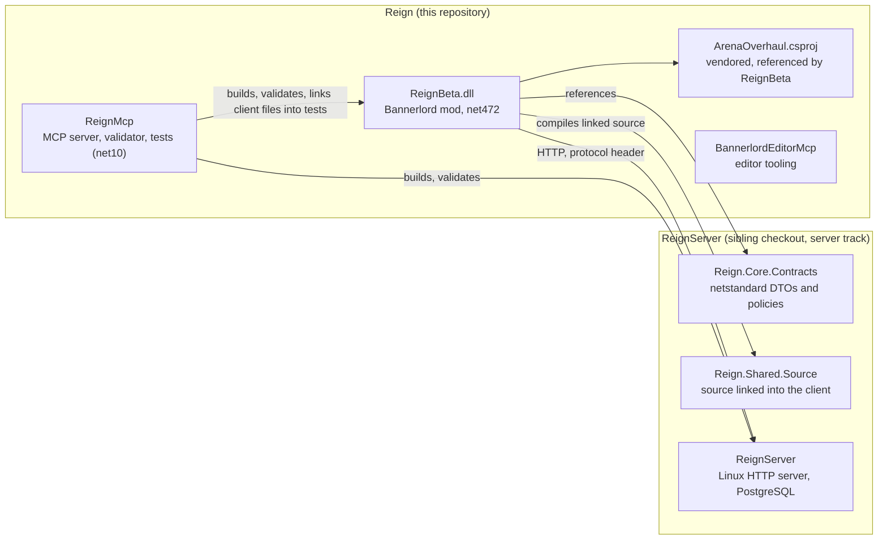

# Reign architecture

Reign is a Bannerlord mod (`ReignBeta`, C# net472) that talks to a separate Linux server (`ReignServer`, C# net10, sibling
checkout reached through the `ReignServer` junction). The client turns TaleWorlds campaign state into requests, and applies
the commands, dialogue and art the server returns. `reign.modules.json` is the machine-readable authority for module
ownership and validation routing. This document explains the layout, the rules every change must keep, and the direction
of the current restructuring programme.

## Repositories and assemblies

- `ReignBeta/ReignBeta.csproj` is SDK-style: it compiles every `ReignBeta/**/*.cs` file except ArenaOverhaul (its own
  project, built to `ArenaOverhaul.1.4.6.dll`) and the deployment-only `server/` and `staging/` trees. It references the
  `Reign.Core.Contracts` project and links `ReignServer/shared/Reign.Shared.Source/**` plus a few other server-owned
  shared files. `ExcludeCourt=true` compiles Court and Spymaster out and defines `REIGN_EXCLUDE_COURT`.
- `Reign.Core.Contracts` and everything under `ReignServer/shared` belong to the server repository. The client consumes a
  contract change only after the server change has merged.
- `ReignMcp` holds the canonical validator. Never build or test directly; see `docs/agent/VALIDATION.md`.
  `ReignMcp/tests/Reign.Mcp.Tests` links about 53 game-free client source files (plus a few server files) and runs the
  client-side xUnit tests.

## Client composition

`ReignBeta/SubModule.xml` loads two submodules: `ReignBeta.SubModule` (`ReignBeta.dll`) and `ArenaOverhaul.SubModule`
(`ArenaOverhaul.1.4.6.dll`).

`ReignBeta/src/Modules/Platform/SubModule.cs` is the Reign entry point. It applies the Harmony patches and the
UIExtenderEx prefabs, and registers every Reign campaign behaviour with `campaignStarter.AddBehavior(...)`. ArenaOverhaul
registers its own `AOArenaBehavior` in `Arena/ArenaOverhaul/SubModule.cs`.

Bannerlord discovers save definitions by reflection: `Persistence/Save/ReignBetaSaveDefiner.cs` for Reign, and
`ArenaOverhaulSaveableTypeDefiner` inside the ArenaOverhaul DLL. Nothing registers them explicitly.

Cross-cutting services in `Platform/Integration`:

- `ReignServerClient`: a `static partial class` with the HTTP transport (local pinned `HttpClient`, request fences,
  correlation IDs, route priorities) and the route methods. Its partial files are spread across module `Integration`
  folders, about 14k lines in total.
- `ReignMainThread`: marshals server results back to the game thread. Campaign state is touched only on the main thread.
- `ReignLog`: the single client logger.

Modules reach each other through `ReignServices` (`Platform/Runtime/ReignServices.cs`), a typed static registry with one
slot per campaign behaviour (41) plus `CourtWorld`. Each behaviour writes its slot exactly where it used to set its static
`Instance`, and keeps an `Instance` property that forwards to the slot; slots are never filled or cleared on game start
or end. `ReignXpCampaignBehavior` (lazy lookup), `AIEventsSettings`, `ReignBetaSettings`, `PortraitRequestScope` and
`ReignTestHarness.Current` stay outside the registry. Court depends on World Simulation, not the reverse: World
Simulation product code reaches Court only through `ICourtWorldBridge` (`WorldSimulation/Domain`), which
`ReignCourtCampaignBehavior` implements and publishes as `ReignServices.CourtWorld` (null when Court is absent), and
reads the household-migration flag from `ReignHouseholdClanMigration`. Only World Simulation test hosts in
`ReignBeta.Testing` still name Court types. Some modules extend another module's behaviour through `partial class` (Spymaster and Government extend `ReignCourtCampaignBehavior`; see each module README).

## Modules

Each folder under `ReignBeta/src/Modules` is one logical module and has a README that lists its layout, public surface,
dependencies and shipped test-harness files.

| Module | Role |
|---|---|
| [Platform](../../ReignBeta/src/Modules/Platform/README.md) | entry point, server transport, settings, compatibility |
| [Persistence](../../ReignBeta/src/Modules/Persistence/README.md) | save definer, Save Sync |
| [Characters](../../ReignBeta/src/Modules/Characters/README.md) | hero identity, family, knowledge, NPC lives |
| [Relationships](../../ReignBeta/src/Modules/Relationships/README.md) | relationship director, player approach |
| [Reputation](../../ReignBeta/src/Modules/Reputation/README.md) | combat, ruler and court reputation |
| [Dialogue](../../ReignBeta/src/Modules/Dialogue/README.md) | conversations, party chat, letters, gossip |
| [Diplomacy](../../ReignBeta/src/Modules/Diplomacy/README.md) | world diplomacy, clan accords |
| [Government](../../ReignBeta/src/Modules/Government/README.md) | governments, parties, hearings |
| [Court](../../ReignBeta/src/Modules/Court/README.md) | court life, dockets, ambassadors, war council |
| [Spymaster](../../ReignBeta/src/Modules/Spymaster/README.md) | spymaster office |
| [KingdomEvents](../../ReignBeta/src/Modules/KingdomEvents/README.md) | kingdom events |
| [Rebellion](../../ReignBeta/src/Modules/Rebellion/README.md) | rebellions |
| [WorldSimulation](../../ReignBeta/src/Modules/WorldSimulation/README.md) | world actions, economy, news, arrests |
| [Portraits](../../ReignBeta/src/Modules/Portraits/README.md) | AI portraits, native portrait patches |
| [UI](../../ReignBeta/src/Modules/UI/README.md) | shared widgets, calibration, art |
| [Arena](../../ReignBeta/src/Modules/Arena/README.md) | ArenaOverhaul and tournaments |

Inside a module, folders name a layer: `Campaign` (campaign behaviours), `Integration` (server clients and adapters),
`Domain` (game-free rules), `UI` (Gauntlet view models and widgets), `Runtime` (Harmony patches and runtime services),
`World`, `Actions` and similar feature folders. Namespaces follow `ReignBeta.<Module>.<Layer>` (for example
`ReignBeta.Court.Campaign`, `ReignBeta.WorldSimulation.Economy`, `ReignBeta.Platform.Runtime`). Exceptions keep their
namespace: partial groups take their owner's namespace wherever the file lives (so some files under Characters declare
`ReignBeta.WorldSimulation.Campaign`); save-registered types (for example `ReignBeta.World`, `ReignBeta.Court`,
`ReignBeta.Events`), prefab-referenced Gauntlet widgets (`ReignBeta.UI...`), `ReignBeta.SubModule`,
`ReignBeta.Actions.ReignActionService` and `AIEventsSettings` keep their old namespaces; third-party code
(`ArenaOverhaul`, `AIPortraits`) is unchanged.
Each module README lists the namespaces it uses.

## Rules every change keeps

- Behaviour on the wire is a contract: route, method, headers and JSON body stay byte-for-byte compatible unless the
  server side has landed a compatible change first.
- Save compatibility is a hard constraint. Never rename, move to another namespace or re-id a type registered in a
  `SaveableTypeDefiner`, or anything serialized by type name, without explicit compatibility code and a save test.
- Domain code (`Domain` folders, `Reign.Core.Contracts`, `Reign.Relationships`) does not reference TaleWorlds,
  HTTP transport or PostgreSQL.
- Campaign state is read and written on the main thread only; background work returns through `ReignMainThread`.
- Optional providers and services fail cleanly when absent.
- PostgreSQL is the only production database (server side).
- A public contract or persistent schema change validates its consumers too.

## Source locations

- Bannerlord client: `ReignBeta/src/Modules/<Module>`.
- Server: `ReignServer/src/Modules/<Module>` (server repository).
- Live-test harness on the server: `ReignServer/tests/ReignLiveTest/Features/<Module>`.
- MCP tools and tests: `ReignMcp/src/Reign.Mcp.Server/Modules/<Module>` and `ReignMcp/tests/Reign.Mcp.Tests/Features/<Module>`.
- Developer tools: `tools/` (repository level) and `ReignBeta/tools/` (Gauntlet previewer, sprite-sheet builder).

## Restructuring direction (2026-11 programme)

The plan is in the programme notes outside the repository and is applied one reviewed PR at a time, without behaviour
change:

1. One HTTP transport (`ReignHttpTransport`) with a typed client per module, replacing the `ReignServerClient` god
   partial; DTOs leave the transport. The Court, Save Sync, Xp and PlayerApproach clients move onto the same transport.
2. A game-free core assembly for protocol, transport, policies and codecs, unit-tested directly from `ReignMcp/tests`,
   replacing source-text tests where it covers them.
3. The in-game test harness (`ReignLiveInteractionTestHost`, `ReignActionGauntlet`, `*/Testing/`, fixtures, calibration
   hosts) leaves the shipped product path; product code reaches it through an interface.
4. Module namespaces `ReignBeta.<Module>.<Layer>` (C10a, done) and the `ReignServices` registry replacing the
   `.Instance` mesh, with the Court and World Simulation cycle broken through `ICourtWorldBridge` (C10b, done). Saveable
   types keep their identities. Some `X.Instance` call sites stay verbatim because ReignServer checks quote them; they
   move once the server quotes are updated.

Update this document and the module READMEs in the same PR as any step that changes these facts.
