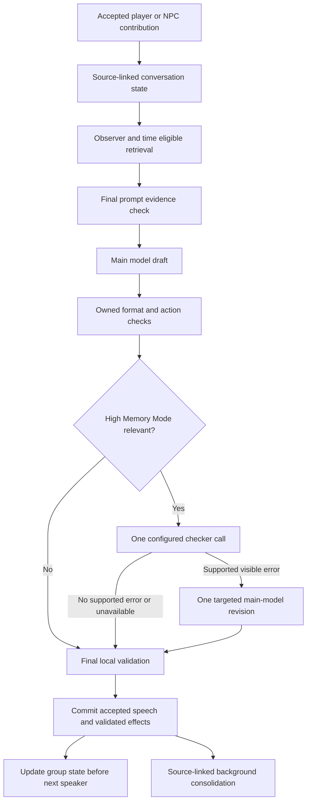

# Reign next-build proposal: remembering characters and coherent group conversation

**Status: Stage25 deployed; native acceptance follow-ups are being validated.** The user authorized build, validation, deployment and testing, then resumed after a play pause. On 2026-09-28 UTC, Stage25 passed product Release Tier 4, repository hygiene and the Linux artifact build, and its exact artifacts were deployed. Guarded BaseThree testing confirmed some corrected-answer and session-reopen recall, but exposed drink handoff/gesture errors, a harmful checker false positive, and missing structured source/question output. Stage26 fixes passed product/hygiene, 1,247 dialogue-pipeline assertions and 429 drink assertions; they are not yet deployed. A further source-citation normalization fix and storage/read regressions are awaiting validation. Broader semantic, native and human acceptance remains incomplete; no issue is closed on compilation alone. Evidence and current implementation state are retained in `.codex-build/dialogue-memory-completion-01a0dbd1/STATUS.md`.

Original proposal prepared for task `01a0dbd1-5dc6-79e3-82b4-3d64bcc922e7`, 2026-09-27 local time. Its fixed audit baseline covers the closed family conversation through 23:35:30 UTC, Constalia through her third event reply at approximately 23:58:21 UTC, eight Ira/Maxax group replies through 2026-09-28 00:29:43 UTC, two Gavene replies through 00:38:14 UTC, and eight later Ira private-tent replies through 01:52:05 UTC. The latest session was ongoing at proposal time. Preparing that proposal itself involved no product build, provider experiment, settings change or campaign mutation.

## 1. Recommendation

**Build a shared conversation-and-memory pipeline around the infrastructure Reign already has, with a specific group-turn coordinator. Strengthen the optional fast checker after the core evidence and state contracts work.** Keep the main dialogue model initially, so measurements can identify what the engineering changes improve. Do not replace the entire memory stack for this build.

The intended behavior is a person who remembers an answer, can disagree with it, can ask a genuinely new question, and can change their mind when corrected. An NPC must not repeatedly make the player re-establish the same history merely because the latest request omitted it. Every route that creates or consumes dialogue or memory belongs in scope.

This is more than another prompt adjustment. The next build needs three connected capabilities: reliable evidence delivery, durable tracking of what the conversation has settled, and validation of both the response and what it will store. The [84-item issue register](DIALOGUE_MEMORY_ISSUE_REGISTER_2026-09-27.md) remains authoritative for individual failures and closure proof. Section 11 maps every ID to work and acceptance; no item is checked off by this proposal.

### 1.1 Consolidated build contract

This is the full next-build scope requested after the latest Ira review. The existing 84 IDs include confirmed defects, deployed protections that need regression coverage, requirements and unfinished acceptance; they are not 84 newly proven bugs. Source-specific reports remain fixed evidence. This document and its issue crosswalk are the implementation proposal, with the following concrete deliverables.

| Deliverable | Behavior the player should experience | Work ownership |
|---|---|---|
| Lasting conversation state | An answered question stays answered even when the NPC dislikes the answer. A new concern is identified as new. Correcting a misunderstanding resolves its dependent episode and obligation before later retrieval. | B1/B4; CONT-01–08, STORE-01–03 |
| Lifetime evidence retrieval | First meetings, accepted plans, letters, relationship milestones and corrections remain reachable after hundreds of conversations. The actual prompt contains the relevant answer, not merely an ID or a clipped summary. | B2; RET-01–10 |
| Group coordination | Each addressed character can answer personally, later speakers take up what was already said, and the player gets an opportunity to answer before anyone claims evasion. Private knowledge remains separate for every listener. | B3/B7; CONT-02/03/05/08, ROUTE-01/05 |
| Source-accountable memory | Statements, subjective motives, hypotheses, intentions, imagined alternatives, observations and native outcomes remain distinct. A model's guess cannot become something the player supposedly said or did. | B1/B4; FACT-01–10, STORE-01–08 |
| Reliable acceptance and recovery | Every dependent write has a durable outcome. Source IDs/revisions are bound locally; concurrent changes are handled explicitly. A failed negotiation/action reports its error separately while preserving safe conversation; unverified agreement/execution claims and dependent effects remain blocked or receive targeted correction. Removing invalid metadata is not reported as successfully remembering the correction. | B0/B4; REP-01–12 |
| Grounded relationship reactions | Proud or suspicious NPCs can react negatively, but invented history, repair omissions or newly introduced questions cannot justify a loss. Genuine positive reactions remain possible, and actual native application is audited separately. | B5; REL-01–06 |
| Drinks | Only accepted consumption by the correct drinker is counted, with vessel/beverage continuity, uncertain volume, deduplication and save/load persistence. | B5; DRINK-01–05 |
| Correspondence knowledge | Authors remember sent letters; recipients know eligible delivered contents; the chat display and an undelivered reply do not grant extra knowledge. | B1/B2/B7; ROUTE-02/06 |
| Faster couriers | New ordinary letter transit is one-quarter of the current duration, applied once; actual delivery checks keep up with the new ETA. | B7; ROUTE-07 |
| Private and evolving relationships | An NPC can recall a secret shared moment without informing another character through private narration. Marriages and friendships can grow independently without rewriting their earlier history. | B1/B2/B7; ROUTE-05, STORE-01/02, FACT-03/04 |
| Optional stronger checking | High Memory Mode checks relevant drafts and proposed writes with a separately configured fast subscription-eligible model; the owning main model performs any revision. Core improvements work with the mode off. | B6/B7; HMM-01–07 |
| Every production route | Individual, group, event, correspondence, official/court/relationship, NPC-to-NPC and background memory paths all use the shared contracts, with route-specific evidence. | B7; ROUTE-01–06 |
| Measured release | Offline regressions, fresh holdouts, long-history and group replay, real save/load, human voice review, product/Linux validation and exact-artifact deployment establish separate parts of acceptance. | B8; ACC-01–08, OBS-01–03 |

The priority within the core build is **prevent false lasting claims and harmful effects; make corrections and answers persist; deliver the right source evidence; make group turns progress; then measure optional checking and ranking**. Do not postpone the core persistence fix while experimenting with a larger model. Do not reduce all disagreement to factual validation: characters keep their own preferences, moral objections, suspicions and right to refuse.

Use the existing Reign services and storage as the initial architecture. No new hardware, commercial memory service or additional subscription is a prerequisite. Fast-checker model selection is an implementation-time benchmark decision among currently eligible subscription models; historical Flash results are not a selection certificate. Keep the main dialogue model fixed for the initial comparison and preserve independent memory-consolidation and relationship model selections.

Existing histories, prior relationship losses and scheduled in-flight mail remain intact. New corrected assertions and removable derived views can make future recall more accurate without editing past dialogue. Work on this proposal changes documentation only; implementation and any deployment are separate future actions.

## 2. What the latest evidence changes

| Finding | Consequence for the next build |
|---|---|
| Individual dialogue has deployed metadata-preservation improvements, but group dialogue still repeatedly changes the question and forgets acknowledgments. | Preserve the working guards. Add explicit question identity and player answer opportunities, rather than treating a recent transcript as sufficient conversation state. |
| The closed family scene contains 13 player turns and 39 NPC replies. The last three mostly accept departure; Temurtai's remaining vulnerability question is distinct from a promise of forewarning. | Do not classify every challenge as a defect. Keep answered, disagreed-with, undecided and newly asked concerns separate. |
| W022 stores “tell me when you know a problem might arise” as “inform me before problems arise.” | Validate qualifications in lasting writes, even when visible prose seems reasonable. |
| Five false historical-lie memories are now confirmed. Words including “settled,” “called,” “startled,” “acknowledges” and “smiled” match the substring `led`, trigger leadership checks, and compare unrelated battle participation. | Fix claim extraction and event binding before adjudication. A checker added only around dialogue will miss unsafe independent writers. |
| The family's final summary is incomplete and ends in the opening exchange, yet remains active and retrieval-eligible. | Separate complete source manifests from complete summarized content. Retain originals and retrieve the missing answer; never let an opening prefix stand in for the whole discussion. |
| Constalia's original office conversation explicitly acknowledges the fourteen prisoners and considers the arrangement settled. The new event makes the player prove it again. A correct summary is loaded but omitted from the final prompts. | Make individual → event continuity a mandatory regression. A nonempty memory section is not proof that the relevant memory survived. |
| Constalia's first event prompt retains a plan to question fourteen prisoners; the first response replaces that with a demand for a report. Later requests lose the earlier plan and store the new “unverifiable delivery” interpretation. | Protect accepted facts from being overwritten by a newly generated plan or suspicion. Trace read → response → write → next read. |
| Constalia's third reply mixes the original band's 17 people with 14 total prisoners across several groups; its new memory says Michael cannot specify a date before he has answered the newly introduced date question. | Preserve count scope and distinguish “not supplied yet” from inability or evasion. These are not exclusively multi-NPC defects. |

Evidence: [final family review](../../.codex-build/investigations/recent-conversations-20260927-2103-01a0dbd1/ongoing-watch/LATEST_REVIEW_W022_W024.md), [Constalia review](../../.codex-build/investigations/recent-conversations-20260927-2103-01a0dbd1/constalia-event/REPORT.md), [Ira/Maxax group review](../../.codex-build/investigations/ira-maxax-group-20260927-01a0dbd1/REPORT.md), [Gavene letter review](../../.codex-build/investigations/gavene-letter-recall-20260927-01a0dbd1/REPORT.md), [Ira private follow-up](../../.codex-build/investigations/ira-private-followup-20260927-01a0dbd1/STATUS.md), and the register's earlier E1–E11 audits. The newer population is 61 responses before three Constalia, eight Ira/Maxax, two Gavene and eight private Ira additions, now 82; historical 81-reply and 53-Ira audits overlap and must not be summed as independent samples.

The Ira/Maxax scene is a positive behavior regression: Ira recalls the private plant conversation, responds discreetly and Maxax remains plausibly unaware. It exposes two internal privacy defects: private narration reaches the next NPC's prompt, and a mixed public/private memory grants all participants knowledge of the private meaning. A separate generated marriage chapter omits earlier disclosures; this is an unresolved provenance question, not proof that their growing closeness is wrong. The user explicitly permits independent NPC relationship development despite the player's shared history. Preserve that freedom and mixed feelings while retaining accurate past events.

Gavene's later in-person conversation exposes a separate cross-route failure. Her outgoing letter is authored, delivered/read and in chat history, but absent from both complete prompts. She denies it, rejects the player's stated reason for visiting, stores a false forgery/fabrication belief and incurs a native-applied −1. Her current prompt also includes the carved-horse memory, but she answers about her real mount. Add canonical correspondence knowledge and entity-bound native authority as blocking regressions; the player's reply is still in transit and must not leak to her.

The user also approved **one-quarter of current letter delivery time**. The reply was scheduled to take 5.3893 game days, while the player arrived after about 2.0193. The approved multiplier yields a 1.3473-day ETA, before that visit. [Courier evidence and route inventory](../../.codex-build/investigations/gavene-letter-recall-20260927-01a0dbd1/COURIER_SPEED_FINDING.md) add ROUTE-07 without adding any dialogue responses to the audit population. This is a timing change for the upcoming build, not a reason to give Gavene knowledge of today's undelivered letter.

The subsequent private Ira exchange provides both a positive control and a hard failure: she takes up the player's correction and applies +3 after a plausible earlier −1, yet reverses whose wish it was to be seen fighting. The main request contains the correct original. The repair's authoritative ledger clips off the decisive sentences, its returned prose is identical, and the system accepts it with failed revalidation. The new correct belief persists, but an episode update with expected revision 2 against stored revision 1 does not; the prior rejection interpretation remains. These cases require exact repair evidence and persistence proof, not just more generation calls. The next three replies add I006 claiming the player's just-spoken correction as its own earlier statement, and I007 turning an ambiguous mention of Rhagaea into her grief, then storing that invented scenario and applying −1 for evasion. Asking for clarification can be legitimate; the invented premise cannot become proven player conduct. I005 successfully accepts the see-versus-fight distinction and I006 answers the requested reciprocal disclosure, so preserve those positive behaviors. The later [continuation evidence](../../.codex-build/investigations/ira-private-followup-20260927-01a0dbd1/FOLLOWUP_I005_I007.md) also distinguishes native acknowledgments from directional-affinity changes.

No new repair-induced relationship reversal was found in the final family batch. Temurtai → Michael received +3; routine positives were capped. Constalia's second negative assessment was neutralized for a missing conduct quote; her first and third routine positives were capped. Zero decline does not prove sound reasoning or correct memory. High Memory Mode was off in these observed replies, so they do not measure its enabled effectiveness.

## 3. What established practice supports—and what it does not prove

There is no single architecture in the reviewed sources that constitutes a universal standard for accurate, believable NPC memory. The useful material falls into formal provenance standards, documented engineering patterns and research evaluations. None certifies Reign without its own tests.

| Primary source | Relevant practice | Application and limit |
|---|---|---|
| [LangChain memory overview](https://docs.langchain.com/oss/python/concepts/memory) | Distinguishes thread state from long-term memory, and immediate writes from background processing. | Keep the current discussion's state separate from searchable lifetime history. Immediate accepted answers must be available before a later speaker responds; expensive synthesis can happen later. Borrow the pattern without introducing LangGraph as a new runtime. |
| [Anthropic context engineering](https://www.anthropic.com/engineering/effective-context-engineering-for-ai-agents) | Curated context, compaction and persistent structured notes; preserve recall before reducing unnecessary material. | Deliver a compact, relevant evidence packet and measure what compaction removes. More context or more instructions alone is not a demonstrated solution. This is vendor engineering guidance, not a reliability guarantee. |
| [Microsoft AutoGen group-chat design](https://microsoft.github.io/autogen/stable/user-guide/agentchat-user-guide/selector-group-chat.html) | Explicit speaker selection, shared contributions, customizable selection logic and termination conditions. | Coordinate who should contribute and when the user gets the floor. Reign can implement this locally; it does not need an additional LLM director for every group beat. Broadcast only what each NPC actually heard. |
| [W3C PROV-O](https://www.w3.org/TR/prov-o/) | Formal relationships for derivation, attribution, quotation and revision. | Use equivalent source/actor/revision links in Reign's existing schema. RDF or a graph database is not required, and provenance alone does not prove a claim true. |
| [Generative Agents research](https://arxiv.org/abs/2304.03442) | Combines recorded experience, retrieval, reflection and planning in a social simulation. | Useful evidence that believable behavior needs more than recall. Reflections must remain derived interpretations, not newly established facts. Its experimental simulation is not acceptance evidence for Bannerlord. |
| [LongMemEval](https://github.com/xiaowu0162/LongMemEval) and [LoCoMo](https://github.com/snap-research/locomo) | Test memory across sessions, updates, time and abstention; retain speaker/turn evidence for questions and event summaries. | Adapt the evaluation dimensions and source labeling. Add Reign-specific group turn order, personality, native outcomes and write-contamination tests that these benchmarks do not establish. |
| [Graphiti](https://github.com/getzep/graphiti) | Temporal facts with provenance and preserved supersession history; hybrid retrieval. | A credible later prototype if Reign's linked records cannot meet the gates. It introduces another storage/runtime integration and model-dependent extraction. Vendor performance comparisons are not adopted as Reign measurements. |

Sources checked 2026-09-27. The LangChain memory overview, Anthropic context-engineering guidance, AutoGen selector-group design, LongMemEval, Graphiti and MiniLM/Qwen reranker pages were rechecked during final consolidation on 2026-09-27 local time (2026-09-28 UTC). Recommendations below are project-specific engineering judgments drawn from these patterns and the retained Reign evidence; the numerical gates are proposed Reign targets, not guarantees from those sources.

## 4. Options and recommended scope

| Option | Expected benefit | Cost / remaining weakness | Recommendation |
|---|---|---|---|
| A. Targeted patches only | Stops substring falsehoods, harmful repair triggers, missing metadata and some provider retries. | Lowest change scope; leaves moving questions, weak group state and answer omission largely intact. | Required first stage, insufficient as the completed solution. |
| **B. Shared state, evidence pipeline and group coordinator** | Addresses the observed causal chain from retrieval through interpretation to storage and future recall. | Medium-to-large engineering change across existing server modules and group client orchestration; no routine extra LLM calls required. | **Core next build.** |
| C. B plus improved optional fast checking | Detects remaining attribution, resolution, qualification and draft/write contradictions. | One extra checker call on relevant responses, plus one main-model rewrite when needed. Quality depends on evidence and measured checker accuracy. | Implement with B; enable only after its own gates pass. |
| D. B plus a local reranker | Better relevance among eligible source candidates, especially long histories. | CPU/GPU contention and integration tuning; cannot validate truth or restore a fact that allocation drops afterward. | Benchmark after B; activate only if it improves measured outcomes and meets the existing certificate. |
| E. Replace memory/orchestration, or change the main writer | May improve difficult temporal queries or residual reasoning. | Migration, privacy/branch mapping, extra operations and possibly extra calls; no automatic fix for wrong writers or missing final evidence. | Defer adoption. Prototype against the same manifest only if B/C miss identified gates. |

For D, compare existing local ranking, the already supported [MiniLM cross-encoder](https://huggingface.co/cross-encoder/ms-marco-MiniLM-L6-v2), and then [Qwen3-Reranker-0.6B](https://huggingface.co/Qwen/Qwen3-Reranker-0.6B) if needed. Their model cards establish relevance-ranking capabilities, not correctness of remembered events. Run local performance measurements with Bannerlord active before selecting one. No new hardware or subscription is a prerequisite.

For E, Graphiti is a possible temporal-memory component; adopting AutoGen/LangGraph wholesale is a separate orchestration rewrite and is not recommended for the existing C# system. A larger writer should be an isolated comparison after identical evidence is delivered, so retrieval improvements are not confused with model changes.

## 5. Proposed shared architecture

An unavailable checker is recorded as unverified, not a successful pass. Failed checks do not manufacture relationship changes. Proven-invalid effects are withheld; a supported visible error that survives the bounded rewrite uses a minimal, grounded fallback rather than accepting the known false claim. Mere lack of evidence is not itself proof of falsehood. Background processing never retroactively upgrades an unverified statement into a native result.

### B0. Freeze evidence and an executable regression manifest

Retain all 53 Ira exchanges, the newer 82 reviewed replies, exact older failures and source/write ledgers. Anonymize fixtures while retaining distinct actors, topics, counts, sequence, corrections and audience rules. Record each case's original evidence, expected required spans, acceptable disagreement, prohibited claims and effects. Preserve successful concealment as well as failure cases. Development examples already inspected here are not holdouts.

Repair bounded audit filtering/pagination and full prompt/attempt inspection where necessary. Every attempted and accepted revision needs trace IDs, request hashes, model/purpose, timing, field changes, evidence omissions and structured repair status. Keep unresolved source gaps as gaps, not passes. Preserve monitoring cursors and distinguish logical conversations, player beats, NPC responses, drafts and retries.

### B1. Extend existing conversation state and typed memory

Extend `ConversationContinuity`, `GroupConversationState`, precision assertions, logical sessions and shared activity records. Do not create a disconnected parallel memory store.

Each question needs an ID, asker, addressees, exact source span, topic, creation turn, player opportunity, linked answer spans, acknowledgment and follow-up links. Track two separate dimensions: **was it answered?** and **does this NPC find the answer convincing?** An answer can be received while the listener remains skeptical. Keep explicit unknowns, deferrals, refusals, resolved issues and abandoned plans distinct. A new narrower question gets its own ID; a reopening needs new evidence, a changed situation or an explicitly renewed request.

Preserve parallel activities separately from prerequisites and readiness conditions. Tournaments, caravans, intelligence and recruiting can proceed together. Asking which weak point is most dangerous must not erase the already explained overall strategy. A proposed direct-contact expectation is not a promise until the other actor accepts it. A player has not evaded a question introduced moments earlier by another NPC in the same batch.

Store bounded assertions with speaker, actor, recipient, audience, source turn/span/hash, event time, record time, campaign branch, evidence kind, qualification and resolution/supersession links. Distinguish speech, observed action, subjective belief, hypothesis, future intention, narrated action, soft character canon and confirmed native result. An NPC may remember that they accepted a report without having independent native proof of every reported act.

Separate the audience of spoken words/observable conduct from player-facing narration and private interpretation. Split mixed-visibility memories before storage; neither participant membership nor a generic private flag grants another NPC knowledge of hidden meaning. Preserve current owner-only thought protections. Relationship-history generation must consider prior disclosures alongside current affinity, shared interests and simulation; preserve old experiences without freezing present feelings or requiring the player to witness every change. Generated background remains distinguishable from source-backed episodes. Conflicting feelings alone are not factual errors and must not force a checker rewrite.

For existing mixed or incorrectly scoped summaries, future retrieval must check the original audience and source spans rather than blindly trusting their stored participant/known-by list. A versioned read-only view can supply the witnessed portion and exclude private interpretation while leaving the historical row intact. If the original audience cannot be established, preserve an explicit knowledge gap; do not treat a group-session ID as proof that every participant knew the secret. Test the full chain into NPC-to-NPC conversation, gossip and later relationship-history generation, not only the immediate group reply.

Use source-bound structured updates proposed in existing main-model output where semantic interpretation is needed, with local identity/sequence checks and optional checker scrutiny. Deterministic rules should enforce identity, ordering and impossible state transitions; they should not pretend to infer every paraphrase's meaning. Ambiguous answer matches stay ambiguous instead of being promoted to deliberate evasion. This adds no routine separate extraction call.

Preserve historical rows. Future retrieval can construct a read-only resolution view over original dialogue, native evidence and acknowledged corrections. New validated corrections can supersede interpretations prospectively; no historical rewriting, refunds or retroactive consolidation are part of this build. Derived views and indexes must be versioned and removable without deleting campaign history.

### B2. Deliver the right evidence in the actual request

Retrieve by current player contribution, relevant preceding NPC contribution, active topic and linked conversation state. Filter by campaign branch, time and observer knowledge **before** ranking. Search the lifetime record, including first meetings and early commitments after hundreds of later conversations; use topic/episode indexes and bounded expansion instead of a recency cutoff that makes old history unreachable.

Retrieve linked bundles: question + answer + acknowledgment; promise + reported/confirmed fulfillment + acceptance; original claim + correction; planned activity + result. Include only necessary source spans, with enough context for pronouns and chronology. Keep current boundaries and important relationship foundations available without repeating the entire relationship history every turn.

Allocate required bundles before optional persona detail, repetitive instructions and unrelated announcements. The relevant answer must survive wherever the old accusation survives. Log separate load, selection, rendering and final-delivery decisions. Protect full records or complete supported spans; never clip an answer into a different meaning. Keep the ordinary dynamic-memory target of 2,000–4,000 tokens with justified expansion. Measure the entire prompt separately and preserve the 40% median total-input reduction target without sacrificing coverage.

For Constalia, deliver the original promise, her later acknowledgment, the distinction between two original-band survivors and fourteen total prisoners, and the later no-fixed-return-date statement together. Do not substitute an old conditional promise for its settled outcome. For the family, deliver the earlier independent-nation explanation and W019's accepted parallel strategy before presenting unresolved risk questions.

A local final-request check must verify required supporting **content**, attribution and chronology, not only source IDs. If a bundle is missing, retrieve or reallocate it before generation. If recovery fails, expose the exact coverage gap to generation/checking and prevent an unsupported accusation or lasting certainty from being derived from the omission. Reconcile indexing backlog and full-text fallback independently; healthy worker status is insufficient.

For correspondence, reuse the existing letter/thread ledger and canonical mail turns. Record observer-relative authorship, dispatch, delivery/read, sender/recipient, body/hash, reply link, event time and branch. The author knows an accepted outgoing letter at dispatch; the recipient gains content at eligible receipt. A sender does not automatically know the recipient read it without acknowledgment. Retrieve a bounded relevant mail packet across dialogue, groups, events, future letters and background processes, with protected authored/received evidence whenever a letter, invitation or written commitment is referenced. A player-facing thread is not the model's evidence packet. Preserve inherited valid letters across save/load and branch recovery, prevent future/other-branch mail leakage, and keep transitions idempotent.

Gavene's acceptance case must include her delivered outgoing letter and the player's statement that he came because of it, while excluding the content of his still-undelivered reply from her knowledge. Missing search results are not proof that no letter was written. Bind the carved-horse token separately from the native charger so an authoritative equipment fact cannot override a different referent; test replicas, namesakes and real ambiguity as well.

### B3. Coordinate group turns while preserving character agency

Current source already has shared contributions, a `quiet` participation mode and instructions against repetition. However, `GroupConversationState.cs:153–181` replaces its open-question list with question-mark lines from the latest NPC reply. The client calls all selected speakers sequentially; order prioritizes one directly named speaker then uses a stable hash. These mechanisms need extension, not another copy of the same instructions.

Use one shared, revisioned conversation state with separate private observer views. Select the speaking floor locally before invoking individual writers; presence alone is not a reason for a generation call. Direct invitations and clear follow-ups permit an answer regardless of personality. Identify all intended people, including named subsets, “both” and “everyone.” Later selected speakers receive accepted contributions and updated answer state before drafting.

**2026-09-28 user refinement:** Traits must drive unsolicited speech heavily. Very high sociability and assertiveness should almost always incline a character to offer an opinion; the opposite combination should speak uninvited hardly ever. Topic relevance, discipline and recent participation are secondary adjustments. Ordinary personalities mostly listen, but do not impose a universal one-interjection cap that flattens several outspoken personalities. Freeze each decision for the logical player turn across retries/reconnects; never reroll to obtain a reply. An open floor may remain quiet, while a named invitation still permits a reserved character to answer. Distinguish current speech, quoted recollections, private whispers and actual action recipients.

Quiet listeners remain in the observer-eligible audience and retain heard originals without fabricated assent, evasion, contributions or penalties. An entirely quiet beat still retains submitted public player speech. Listening does not increment an ignored-turn counter or expel a social-event participant. Apply the shared selection to party/castle/family/home groups, social/generated events and tavern-house visits; single-person conversations retain their normal addressee. The Stage29 implementation is under validation; this note does not close native or human acceptance.

Forward only that observer's audible/visible portion of the accepted contribution. In the Ira/Maxax regression, Maxax may see Ira examine a plant and hear her advice; he must not receive narrator-only knowledge that it recalls a private exchange. Preserve observable subtle tells and proportionate suspicion when warranted; do not create jealousy merely because the system knows a secret. Include a contrasting actual-disclosure case and verify subsequent memory, gossip and relationship effects.

A selected later contribution may add a relevant fact, answer, personal position, consequence, correction or reaction. A brief acknowledgment or silence is valid; do not require a novel contribution or new demand from each person. A genuinely important disagreement can remain; repeating it requires a changed circumstance, unanswered relevant point or explicit continuation, not merely another speaker's turn.

Track the player-turn boundary independently of NPC response order. Freeze “has the player had a chance to answer?” for newly introduced questions until input returns to the player. Do not fabricate assent, evasion, gestures or emotional reactions while the player cannot intervene. Preserve multiple open concerns without replacing answered ones or allowing the last speaker to overwrite the group's decisions.

Keep progressive delivery. Each NPC's accepted response becomes available to later speakers, but never publish a draft then visibly replace it after checking. Use stable turn IDs and optimistic revision checks so retries, identical player text and reconnects cannot duplicate effects or collapse legitimate repeated inputs. Terminate the current group beat when its substantive contributions are complete and return the floor to the player.

Group implementation choices:

| Approach | Tradeoff | Decision |
|---|---|---|
| Local coordinator, separate NPC writers | Preserves private knowledge and existing character pipelines; some responses still require separate generation. | Recommended initial implementation. |
| One main-model call writes the entire group | Potentially fewer calls, but larger role/knowledge mixing risk and changed delivery/repair semantics. | Offline comparison only after the shared contracts pass. |
| Extra LLM director or whole-group checker | Could reason about the whole exchange, but adds calls or buffers all responses before delivery. | Optional later experiment with an explicit changed call budget; not silently part of High Memory Mode. |

### B4. Make validation and lasting writes one controlled acceptance path

Use the I004 source-supported inversion as a critical fixture: the repair must receive the exact offending clause, original attributed sentence and actor/experiencer/observer roles. A 420-character narrative prefix and generic shared words are insufficient. A correct summary elsewhere in the draft does not excuse a contradictory visible line. Check changed output and dependent writes; unchanged known-invalid prose must retain an honest unresolved result and follow the bounded failure policy rather than silently passing as corrected. Preserve legitimate positive correction metadata and character voice.

Bind source references and expected current revisions from the retrieved records outside model-authored content. In the same I004 fixture, a new belief/comprehension stores the correction while the episode remains at revision 1 because the proposal expects revision 2. Verify individual write receipts and next-request state; a proposal is not a committed update. Preserve concurrency checks, distinguish stale model metadata from a genuine intervening edit, and recover or explicitly mark the dependent update incomplete without duplicating native effects. Do not retrospectively edit the audited campaign. I005 adds a discontiguous evidence quote assembled across a stage direction, and local repair removes the whole update; I006 again expects revision 2 against stored revision 1. Use a real contiguous source span or explicit multiple spans, preserve guards, and report the missing dependent write instead of equating removal of invalid metadata with successful memory resolution. Verify corrections, conflicting subjective interpretations and the genuinely open next question separately. I006's correct decision-brief fact must agree with visible speaker attribution; I007's ambiguous mother reference must remain ambiguous until clarified, including in stored summaries and penalty evidence.

For empty outputs, separate I003's raw `{}`/length response (7,990 reasoning tokens within an 8,000-token completion budget) from I004's raw `{}`/stop response (6,010 completion tokens, 4,324 reasoning). Verify provider-specific reasoning and answer-budget behavior under fixed evaluation manifests. Existing one-attempt format recovery succeeds in both; avoid conflating its success with the later failed semantic repair or adding blind retries. Warnings accepted unchanged must remain warnings, not reported as removed defects. I005 and I007 add successfully recovered raw `{}`/stop cases (5,288 and 3,128 completion tokens); I006's extra call only supplies a missing empty proposal array. Measure useful field changes, semantic defects left untouched and local versus provider repairs separately. Under REL-06, investigate requested +3 versus observed native +6/+7 without assuming a duplicate application or silently changing native modifiers. I008 subsequently understands the explicit Maxax/maternal-help clarification, but the proposed resolution again misses the old revision while a new agency agenda commits. The obligation to share his imagined options also stays unresolved after he answers. Acceptance must close that answered obligation and old misunderstanding independently of the new disagreement; agreement with the answer is not the criterion for having answered. The incorrect grief memory is already supplied again, so test retrieval preference for the original statement and correction without modifying history.

First fix the proven `led` substring classifier. Extract an actual asserted actor/action/event span before selecting a historical claim family. Token boundaries alone are insufficient: “I led a toast,” a quotation, a future intention and another actor's deeds are different claims. Require the matching event and knowledge scope before adjudicating contradiction. Unknown or partial evidence must not become a detected lie because a participant was not the commander. Do not store an entire mixed monologue as a factual belief.

Give each repair declared field ownership. Preserve unrelated valid metadata, including positive assessments, memory writes, refusal and consent. A changed claim invalidates only its dependent proposed facts, obligations, relationship rationale and actions. Validate replacements against the same versioned evidence and reject newly introduced contradictions. Replace generic shared-word agency matching with specific actor/claim conflicts; retain F01 as a blocking regression.

Arrange repair stages so verification applies to the **accepted revision**. The current event pipeline places High Memory Mode before a later agency stage. Either complete potentially substantive stages first, or invalidate the checker receipt whenever later content changes; do not spend a hidden second checker call. Bind receipt, writes and native effects to the accepted response hash and evidence version.

Stage proposed effects and commit validated results idempotently with the accepted response. Bind source identifiers, current record revisions and accepted response/evidence hashes outside the model. Require an explicit result for each requested episode, obligation, belief and memory update; locally validate that the next-read view reflects an accepted correction. Where dependent updates share a database, apply them together when their contract requires it. If storage spans resources, use the existing durable receipt/outbox mechanisms so partial failure is recoverable; do not claim distributed atomicity from a database transaction alone. A genuine concurrent edit requires rereading/reconciling the current state, not disabling the revision guard. Do not mark a response's memory update successful merely because a new concern was saved while the old answered one was left active. Preserve the accepted transcript, expose a recoverable incomplete-write result, and suppress unsupported dependent effects until resolution; retries must never reapply relationship or drink effects. Prevent rejected drafts and incomplete summaries from entering authoritative retrieval. Preserve raw sources when consolidation fails, mark exact uncovered spans, and allow only supported complete extracts to compete as evidence. Bounded retry recovery must not recycle a cached `{}` as fresh work.

Investigate provider empties from raw envelopes, finish reasons, supported schema mode, extraction and effective output limits. Separate `stop` with `{}` from length truncation and adapter failures. Complete genuinely empty optional structures locally; do not invent negotiation proposals to satisfy schema. Apply bounded request-purpose budgets across existing repairs rather than stacking independent blind retries.

Structured repair status becomes authoritative everywhere, including group contribution storage and web audits. Keep old `..`/`.,` markers readable for history only. Report format recovery, metadata correction, visible revision and unresolved issues separately. Fix clipped character fields and `System.Object[]` rendering through typed serialization rather than another dialogue instruction.

### B5. Keep relationship and drink outcomes grounded

Evaluate the NPC's interpretation against the actual current contribution, known boundaries, prior answers and accepted corrections. A matching quote is necessary evidence in some cases but is not proof of the proposed interpretation. Missing quotation metadata may be filled only from an identified supporting span; if uncertain, withhold that effect and explain why in the audit. Do not simply loosen the gate to make relationship numbers decline.

Preserve proud, suspicious, jealous and disagreeable reactions. An ordinary supported perceived slight remains routine and capped at -1; independently supported stronger conduct may justify a stronger loss. Test meaningful gains too, so repairing a false accusation does not flatten the relationship system. Record raw, normalized, capped and native outcomes with observer/target direction. A critical sentence does not automatically require a penalty.

Keep drink events keyed to accepted actor/action/vessel/beverage and logical turn. Cover sip/pull constructions, shared skins, handoffs, refills and negative examples including W022's explicit non-drinking cup handling. Count events separately from known or estimated alcohol quantity. Unknown volume remains unknown; an unspecified pull is not a standard drink. Deduplicate all recovery paths and verify persistence without changing existing intoxication thresholds or campaign-time recovery.

### B6. Strengthen High Memory Mode within its agreed limits

Keep the existing UI toggle off by default and its separately selected Memory Checker Model. Memory consolidation, relationship and dialogue model selections stay independent. Require an eligible configured checker; never silently substitute the main writer. Keep the configurable 10-second checker timeout initially. GLM-4.7-Flash remains a prior fast candidate, not a certified selection; test currently subscription-eligible candidates against the same cases before recommending activation. Clearly explain the distinct model roles in settings and display the selected checker when enabled; a blank checker cannot mean an undisclosed fallback. The audit must distinguish off, not needed, checked, corrected, timed out, rejected finding and unresolved. Reuse the existing settings and audit surfaces under the interface rules rather than putting diagnostics into ordinary character speech.

Replace an isolated quotation check with a compact **conversation-state and source check**. Supply the draft, proposed lasting updates, current question/answer links, player-opportunity state, relevant accepted decisions, observer identity and exact original source spans. Trigger on memory claims, quotations, corrections, reopened concerns, promise/plan changes and lasting writes—including resolved-topic disputes that do not use “remember.”

The result identifies the disputed clause/field, error category, source references and uncertainty. It may flag wrong attribution, changed question, false reopening, lost qualification, wrong scope/count, contradictory write or redundant demand with no new basis. Repetition and disagreement need separate classifications: the checker must not treat skepticism or character preference as factual error. Source identity, exact quote binding, timing and permitted fields are validated locally; confidence alone is not evidence.

The ordinary preflight should already deliver required evidence. If local post-draft lookup recovers a missing original, restrict it to the same observer, branch and time cutoff; identify it as **newly recovered evidence**, not evidence the first draft saw. Any visible correction must send that evidence to the main writer. This extends the current checker evidence contract deliberately while adding no separate lookup-model call. It does not permit private cross-character knowledge leakage.

Use at most **one checker call and one semantic rewrite per NPC response**. The main writer alone revises visible prose. The checker cannot select relationship numbers, write prose, execute actions or invent facts. Preserve new feelings and authorized intentional deception as distinct from factual recall mistakes.

| Case | New memory-path calls, excluding existing format/action recovery |
|---|---|
| Mode off, or an irrelevant response | 0; one ordinary main response call. |
| Relevant response passes or checker is unavailable | 1 checker; normally 2 calls total. Unavailable means unverified. |
| Supported visible error needs revision | 1 checker + 1 main rewrite; at most 3 calls total. |
| Three relevant NPC responses in one group beat | Normally 6 calls, at most 9 if each needs its permitted rewrite. This is not “two calls for the whole group.” |

No hidden precision-ambiguity helper calls. Malformed, unsupported and false-positive findings are rejected; timeouts cannot create penalties or successful-verification badges. A failed rewrite cannot authorize a known-invalid stored claim. Preserve unrelated accepted facts/effects. Log checked/unchecked claims, rejected findings, evidence gaps, changed fields, fallbacks and elapsed/cost data. These measurements establish whether the extra checker helps enough to justify it.

### B7. Apply the same contracts through every route

Implement shared evidence, state and acceptance services with thin route adapters. “Uses the same model” is not route coverage. Inventory actual generation and persistence call sites before edits; each must be tested or explicitly marked unsupported.

| Route | Mandatory additional proof |
|---|---|
| Individual dialogue | Ira attribution, reciprocal answers, corrections, earliest relationship history and current boundaries. |
| Party, family, castle and council conversations | Player opportunity, multiple addressees, distinct contributions, delivered versus pending/quiet turns, local/native continuation. |
| Social and wilderness events, tavern-house scenes | Constalia's settled private history survives event entry; correct shared venue, event-result scope and scene completion. |
| Correspondence and delivered replies | Authorship at dispatch, recipient content at eligible receipt, observer-relative direction, thread/reply/invitation links, early-letter recall and protected delivery into later conversations. Gavene must remember her own sent letter while remaining unaware of the in-transit reply. Drafts, global read receipts and UI display do not automatically establish NPC knowledge. |
| Official, court, relationship and other role conversations | Same memory and relationship guards without bypassing domain action/authority checks. |
| Generated openings and event dialogue | Correct participants, identity/gender, role and known history before the player responds; draft generation is not a played event. |
| NPC-to-NPC dialogue, gossip and autonomous exchanges | Speaker/recipient/audience identity, source-attributed reports, privacy and no automatic firsthand status. |
| Background consolidation, beliefs, world-history interpretation and retrieval | Same source/qualification/resolution rules at publication and reuse; incomplete generation cannot contaminate later routes. |

For a memory-relevant generated/background unit, High Memory Mode may use the same bounded optional checker; its owning main generator/consolidator performs any revision. A non-text writer uses local rejection/deferral instead of invoking a dialogue model. The unit, purpose and call budget must be explicit in the manifest. Checking remains off everywhere when the mode is off. Current approved scope of this proposal does not authorize running these calls now.

Reuse current controls. Improve audit clarity and role labels where necessary within [interface rules](REIGN_INTERFACE_DESIGN_RULES.md); do not expose source hashes, checker internals or schema jargon in ordinary character dialogue. Test settings persistence and the applicable provider-free previews, layout and native acceptance for any interface edits.

**Courier timing, ROUTE-07:** Use one versioned policy to apply `newTransit = oldTransit * 0.25` once to new letter dispatches, including player, NPC reply, autonomous, relationship-development and court mail. Scale existing base delays, distance terms, caps, unknown-position defaults and the ordinary minimum consistently: 0.25 day becomes 0.0625 day; fixed three-day mail becomes 0.75 day. Preserve zero-delay urgent reports. Reconcile every API/producer floor and pass original-duration/policy provenance so a reply does not quarter an already adjusted duration. Old-policy incoming mail and new-policy incoming mail need separate reply tests. Preserve already scheduled historical/in-flight mail under the future-only boundary.

Separate message transit from an event prerequisite: a faster shipment notice cannot assert delivery of goods before the native result. Do not accelerate shipments, generation cooldowns, relationship updates or local one-hour gossip; explicitly inspect shared distant-gossip transport dependencies. Due-letter checks should run at least hourly without extra LLM calls, with measured ETA-to-delivery lag and no change to unrelated simulation cadence. Test actual native delivery, not just shorter displayed ETAs. The detailed route, boundary and persistence cases are in E16.

## 6. Delivery sequence and dependencies

| Stage | Work | Exit condition |
|---|---|---|
| 0. Baseline and immediate integrity fixes | B0; B4 claim classifier, source-bound agency trigger, invalid-cache and incomplete-publication safeguards. | Exact harmful cases reproduced and prevented, with legitimate history/deception/agency controls retained. |
| 1. State and evidence | B1, B2; source/schema compatibility and final-request proof. | Answers, corrections, settled outcomes and early history survive retrieval/compaction. Constalia and family sequences pass with High Memory Mode off. |
| 2. Group behavior and common acceptance | B3, remaining B4, B5, B7 adapters. | Whole multi-NPC sequences progress; no false evasion before player input; all routes use validated effects and preserve personality. |
| 3. Optional checking | B6 through the same B7 adapters. | Off-call bounds and enabled semantic-quality/failure tests pass; checker receipt covers accepted output. |
| 4. Measured acceptance and release preparation | B8: ranking/model comparisons, holdouts, native/human review, product/Linux artifacts. | Gates below pass, or the relevant optional component stays disabled and its scope remains explicitly incomplete. |

This is a substantial coordinated build, not a promise that one small patch will solve all conversation behavior. Stages are independently reviewable but should not be advertised as full memory acceptance merely because they compile. A narrowly scoped interim integrity release is possible if requested; it would not close the group/memory goals.

Primary existing server owners: `Dialogue/ConversationContinuity.cs`, `GroupConversationState.cs`, `LogicalConversation.cs`, `MemoryContextV2.cs`, `CategorizedMemory.cs`, `MemoryPrecision*.cs`, `PromptCaching.cs`, `HighMemoryMode.cs`, `DialogueIntegrity.cs`, `MotiveAwareConversation.cs`, `LieDetection.cs`, `WorldSimulation/WorldHistory.cs`, `SocialEventTurns.cs`, route handlers in `Platform/Program.cs` and `Relationships/Relationships.cs`. Confirm exact current ownership before edits. Client group ordering/delivery currently resides in `ReignPartyChatScreenVM.cs`, `ReignPartyChatSession` and their server-client adapter. Server-owned files must be edited in the sibling server repository, not treated as independent client-owned junction files.

## 7. Acceptance that measures remembering, not just passing checks

Retain earlier approved gates and add explicit group/write quality. The additional numerical thresholds below are **proposed Reign release targets**, not industry certification figures.

| Area | Required proof / gate |
|---|---|
| Critical observed defects | Zero recurrence in the fixed regression manifest: repair-induced relationship reversals, attribution-changing repair, unchanged accepted speaker inversion, clipped decisive repair evidence, silent loss of an acknowledged correction through wrong revision/source IDs, false `led` history, known answered-question reopening, false player evasion before an answer opportunity, unrelated metadata loss and duplicated native effects. |
| Required evidence | At least 98% of labeled required source **content bundles** in actual final requests, reported per route as well as overall. Report answer-span coverage separately, also at least 98% for answer-required cases. Missing evidence cannot be scored as a correct abstention. |
| Generated factual fidelity | At least 98% of independently labeled factual claims/answer-state decisions supported, with all critical identity, question ownership and harmful-write cases passing. Report error counts, uncertain claims and confidence intervals; do not hide a weak route inside a pooled average. |
| Answer behavior | At least 95% substantive answer uptake on answerable holdout opportunities; at most 5% unnecessary abstention. New legitimate questions and explicit “undecided” answers count according to their actual state, not against a forced answer template. |
| Group progress | Zero false unanswered accusations before player opportunity in the manifest. Target at least 80% fewer redundant demands than the frozen baseline, without suppressing distinct addressed opinions or legitimate unresolved concerns. Human labels distinguish reiteration for a reason from empty repetition. |
| Stored memory | Source spans, actors, qualifications, uncertainty, count scope and supersession correct in all critical fixtures; at least 98% supported held-out lasting assertions. Incomplete summaries preserve originals and advertise missing semantic coverage. Test the next retrieval, not only the write. |
| Relationships | Zero repair-induced sign reversals or source-fabricated penalties; supported ordinary slights remain possible at -1 maximum. Verify meaningful gains, caps, observer/target and actual native receipts. |
| Drinks | Exact accepted event counts in all positive/negative, handoff, retry/rewrite and save/load cases. Quantity uncertainty remains explicit; thresholds unchanged. |
| Letter delivery and recall | New transit duration equals 0.25 times the old policy exactly once, across all eligible producers and boundary/fallback/reply cases. Gavene's 5.3893-day fixture becomes 1.3473 days and arrives before the 2.0193-day visit. Proposed healthy-runtime delivery lag is at most one game hour after eligibility. Verify save/load, duplicate ticks, existing in-flight preservation, source-event prerequisites and recipient knowledge only after receipt. |
| High Memory Mode | Off produces zero added calls on every route. On: at most one checker and one semantic rewrite per unit, timeout/failure honestly reported, no unsupported findings accepted, no new contradiction from revision, no harmful false correction in critical controls. |
| Voice and naturalness | Blind before/after human review across skeptical/proud/affectionate/private/public scenes. Proposed mean at least 4/5 naturalness and no reduction in character distinctness; report unnecessary corrections and repetitive gestures/lectures separately. |
| Input and latency | Preserve 40% median total-provider-input reduction on equivalent work while meeting evidence gates; dynamic 2k–4k target is not the total prompt. Report initial and retry/rewrite tokens, cache tokens, p50/p95 retrieval, generation, checker, first visible response and completed group beat. |
| Operational safety | Index freshness/fallback, worker contention with Bannerlord, interrupted writes, duplicated requests, campaign branch isolation, save/load, continuation and rollback tested through supported harnesses. |

The latest pre-proposal source replay is **252/272 (92.6471%)**, below the 98% gate. The older 100/100 answer-source presence result is not generated-answer accuracy. Prior product validation and five successful isolated rewrite probes remain useful evidence but do not establish these gates.

## 8. Test design and model/ranking decisions

Use all known failures as development regressions, then freeze **at least 100 independently labeled holdout cases from other conversations**. Include at least 40 multi-turn group/event cases and 20 cross-route continuations within or beyond that set; supplement until every route has meaningful coverage. If existing holdouts have been inspected or used to tune the code, move them to development and obtain fresh ones. An independent human labeling pass is still required; an automatic judge can assist but cannot replace it.

Replay each turn with only evidence available at that point, its audience and campaign branch. Later corrections cannot leak into earlier prompts. Test early memories after 300+ conversations, distractor episodes, near-duplicate questions, “both/everyone,” interrupted/repeated player inputs, question-before-opportunity, parallel plans, actual refusals, deception, sarcasm and legitimate slights. Include the latest conditional promise, closed-scene fallback, Constalia's fourteen-total/two-original case, Ira/Maxax's successful concealment and independent relationship development, and Gavene's own-letter/in-transit-reply/carved-horse sequence. Test actual disclosure separately from private narration and intentional denial separately from an unsupported belief that an authored letter never existed.

Run three distinct measurements: **retrieval alone**, **writer with oracle evidence**, and **full retrieval → writer → validation → store → next-turn retrieval**. This separates omitted evidence, model misinterpretation and persistent contamination. Oracle evidence is a diagnostic upper bound, not a production score. Keep source-only deterministic replay separate from provider-generated and human/native acceptance.

Compare incrementally on the same manifest: deployed baseline; B with checker off; B with checker on; B plus local reranker; only then a different writer or Graphiti prototype if a remaining failure warrants it. Do not change model, retrieval and prompt simultaneously and attribute the improvement to one component.

Before provider evaluation, freeze model IDs/provider profiles, subscription eligibility, case counts, call ceilings, input/output limits, retry budget, estimated quota/cost and stop conditions. The basic checker comparison for N relevant single-response cases is N main calls + N checks + at most N rewrites, plus separately bounded existing recovery. Group costs count each NPC response. Historical subscription eligibility does not prove zero charge today; stop on unexpected billing/routing or the fixed budget. No new paid/subscription tests were run for this proposal.

Local reranker activation requires the existing precision quality gates and certificate. Check game responsiveness, memory use and index reliability, not just retrieval latency. Checker selection favors measured source-grounded precision and low delay over model size; the previous nine-case Flash result is too small and still has known false positives. Set a performance budget from the initial measured cohort before the larger run rather than inventing a current latency guarantee.

## 9. Build, native acceptance and deployment

Before implementation, inspect current same-project ownership and both repositories, get the exact changed-path validation plan and recheck the lease. Anticipated scope is **product Release Tier 4**. If manifest/tooling/ownership changes require `all`, use the broader selected plan; do not force Tier 4 to avoid coverage. Update `reign.testing.json`, procedures, security/help and contracts together when harness interfaces change.

Run relevant memory, dialogue, group, relationship, drink, provider-routing, Save Sync and web-preview checks through the canonical validator, then the Linux artifact build. Retain fingerprints, source commits, report/hygiene paths and exact artifact hashes. Reuse successful unchanged artifact reports where permitted. Offline checks can run independently of a production conversation; do not control the user's live game during planning.

Native acceptance uses the authorized **BaseThree baseline only through an enrolled, verified disposable copy**. Recheck the existing task run/copy and Save Sync's 15-state capacity before any use; the prior 8/15 snapshot is not current authorization to consume more. Pause time, drain work, inspect failures/in-flight jobs, then checkpoint. Test individual → event → group → save/load, long conversations, early relationship recall, optional checking, drink vessels and native relationship application. Retain a normal player-facing human session for voice/naturalness acceptance.

Deployment remains a separate step using exact validated artifacts in the authorized window. Precision stays shadow, reranking disabled and High Memory Mode off until each proposed activation is supported by its measurements. If one optional component fails, report it and leave it disabled; do not describe the overall semantic goal as complete when a required gate remains unmet.

Rollback restores prior software/configuration and retrieval mode while retaining campaign progress. Use additive compatible schema changes, versioned derived views and provenance. Do not restore an old campaign backup just to undo software; do not rewrite historical records or refund relationship losses.

## 10. Example intended behavior

These are illustrative writing targets, not provider results or mandatory scripts.

- Family: “I remember: tournaments fund the caravans and company, and buying land gives us a start beyond another ruler's claim. I still worry about defending the first town. Have you chosen where that might be?” This acknowledges the plan, preserves skepticism and labels the follow-up as new.
- Temurtai after the latest answer: “Then tell me when you see the danger coming. I still want to work out which part is most exposed, but we can do that on the road.” Conditional promise preserved; no retroactive evasion accusation.
- Constalia: “I remember the fourteen prisoners—and that you wanted no reward. I meant what has happened since we last spoke.” Her prior acceptance survives; current results may still be queried.

## 11. Complete issue-to-work crosswalk

**B0** evidence/manifest; **B1** state/provenance; **B2** retrieval/allocation; **B3** group coordination; **B4** validation/writes/repairs; **B5** relationships/drinks; **B6** optional checking; **B7** route adapters; **B8** measured/native/release acceptance (sections 7–9). “Retain/test” preserves deployed safeguards; it does not claim those old bugs still occur. All checkboxes remain in the issue register.

| ID | Primary work | Disposition and closure focus |
|---|---|---|
| RET-01 | B2 | Fix loaded-but-undelivered answers; family and Constalia actual-request proof. |
| RET-02 | B2 | Protect answers against allocation loss beside adverse concerns. |
| RET-03 | B1/B2 | Retrieve question, answer, reciprocal question and acknowledgment together. |
| RET-04 | B2/B8 | Current topic/NPC context ranking; close exact missing-source fixtures. |
| RET-05 | B2 | Remove irrelevant announcements/persona duplication without losing identity. |
| RET-06 | B2/B4 | Retain/test negated and metaphorical intimacy guard. |
| RET-07 | B2/B8 | First meeting and early commitments after 300+ conversations, including native. |
| RET-08 | B0/B2 | Certify full request content and hashes, not loaded IDs. |
| RET-09 | B2/B8 | Index freshness, timeouts and fallback coverage under live resource load. |
| RET-10 | B2/B8 | Whole-prompt reduction, typed rendering and evidence preservation. |
| CONT-01 | B1/B6 | Exact asker/answerer and reciprocal ownership. |
| CONT-02 | B1/B3 | Player opportunity; no invented answer, silence or reaction. |
| CONT-03 | B1/B3 | Follow-ups are new questions; retain earlier acknowledgment. |
| CONT-04 | B1/B6 | Answered versus unconvincing, unknown, deferred and unanswered. |
| CONT-05 | B3/B8 | Distinct contributions, uptake, justified repetition and voice. |
| CONT-06 | B1/B7/B8 | Retain implemented logical continuation; native/save-load/idempotency proof. |
| CONT-07 | B1/B2 | Source-backed activity completion, partial outcomes and explicit reopening. |
| CONT-08 | B1/B3 | Preserve parallel strategy versus prerequisites and risk questions. |
| FACT-01 | B4/B6 | Correct evidence interpreted correctly; oracle versus end-to-end comparison. |
| FACT-02 | B1/B4 | Exact quotations and acknowledged corrections remain linked. |
| FACT-03 | B1/B4 | Intention/hypothesis/completed result and qualifications stay distinct. |
| FACT-04 | B1/B2 | Correct episode, time and location; similar-scene distractors. |
| FACT-05 | B1/B4/B7 | Actor, recipient set and direction, including letters and fear repair. |
| FACT-06 | B1/B4 | Preserve selected/deferred exclusive options. |
| FACT-07 | B4/B7 | Identity/gender across generation, storage and retrieval. |
| FACT-08 | B1/B4 | Exact count scope/completeness; original band versus total prisoners. |
| FACT-09 | B4/B7 | Narration and acknowledged reports do not forge native outcomes. |
| FACT-10 | B1/B2/B4 | Bind native authority to the exact entity; carved token versus riding horse. |
| STORE-01 | B1/B2 | Prospective supersession; original records intact, next recall verified. |
| STORE-02 | B1/B4 | Prevent unsupported historical premises becoming durable beliefs. |
| STORE-03 | B4/B6 | Preserve conditions, negation and scope; W022 and Constalia fixtures. |
| STORE-04 | B1/B4 | Separate temporary feeling, metaphor and stable trait. |
| STORE-05 | B2/B4 | Retain prefix guard; prefer originals over misleading legacy summaries. |
| STORE-06 | B4/B7 | Incomplete consolidation cannot stand in for resolved whole scenes. |
| STORE-07 | B4 | Fix specific claim extraction, event match and falsehood publication. |
| STORE-08 | B1/B4 | Bound and attribute claims; no whole monologue promoted to fact. |
| REP-01 | B4 | Retain/test field preservation, including meaningful positive effects. |
| REP-02 | B4 | F01 actor-bound repair; reject newly introduced contradiction. |
| REP-03 | B4 | Reject weak agency matches; stop unchanged unsupported retries. |
| REP-04 | B0/B4/B6 | Separate structural recovery from factual validation. |
| REP-05 | B4 | Local genuinely empty structures; valid proposal keys/evidence only. Old negotiation records must not force unrelated new decisions. Failed action/negotiation metadata must preserve safe prose with a separate failure status; retain quote/consent guards. |
| REP-06 | B4 | Diagnose `{}` stop/length/envelope/schema failures; bounded recovery. |
| REP-07 | B4/B7 | Authoritative venue reconciled without unrelated motive edits. |
| REP-08 | B4/B5 | Metaphor versus action/payment with correct actor and native evidence. |
| REP-09 | B3/B4 | Repeated meaning and instruction leakage, not only gesture cleanup. |
| REP-10 | B4/B6 | Dependency invalidation and accepted-revision binding. |
| REP-11 | B0/B4 | No cached invalid retry loops or duplicate logical resolution effects. |
| REP-12 | B0/B4/B7 | Structured status authoritative, including group-state writers. |
| REL-01 | B4/B5 | Retain grounded fallback; no arbitrary/hash/negation sign errors. |
| REL-02 | B5 | Resolve evidence omissions without weakening legitimate-negative proof. |
| REL-03 | B1/B5/B6 | Surrounding conduct and answer history justify interpretation. |
| REL-04 | B4/B5 | Reconcile prose, belief, evidence and receipt without forcing a penalty. |
| REL-05 | B5/B8 | Legitimate -1 slights, stronger supported conduct and meaningful gains. |
| REL-06 | B0/B5/B8 | Proposed/normalized/capped/native and relationship direction separately. |
| DRINK-01 | B5/B8 | Retain/test exact sip/pull grammar and native positive cases. |
| DRINK-02 | B1/B5 | Drinker/vessel/beverage handoffs, refills and uncertain volume. |
| DRINK-03 | B5 | Separate accepted events from alcohol quantity estimates. |
| DRINK-04 | B4/B5 | Negative controls and retry/rewrite idempotency. |
| DRINK-05 | B5/B8 | Save/load and existing thresholds/recovery unchanged. |
| ROUTE-01 | B7 | Every production route has an adapter and behavioral proof. |
| ROUTE-02 | B1/B7 | Itaria travel-direction and source-time regression. |
| ROUTE-03 | B4/B7 | Generated versus played openings; Hulara and Constalia route cases. |
| ROUTE-04 | B1/B4/B7 | Background consolidation/publication and subsequent retrieval. |
| ROUTE-05 | B1/B2/B7 | Witness/audience/private/draft/received eligibility. |
| ROUTE-06 | B1/B2/B4/B7 | Letter authorship/receipt lifecycle, protected cross-route recall, no in-transit leakage, save/branch/idempotency proof. |
| ROUTE-07 | B7/B8 | Quarter ordinary transit once across all producers; scaled floors/fallbacks, urgent/event exceptions, old/new reply versions, hourly delivery and native save/load proof. |
| HMM-01 | B6/B7 | Retain independent settings, checker prerequisite and profile persistence. |
| HMM-02 | B6/B7 | Off zero; on one check/one rewrite; no hidden helper calls. |
| HMM-03 | B6/B8 | Fresh labeled checker precision, missed errors and uncertainty tests. |
| HMM-04 | B4/B6 | Main writer owns targeted visible revision and valid effects. |
| HMM-05 | B4/B6 | Timeout/malformed/unsupported/failed-rewrite behavior tested. |
| HMM-06 | B0/B6/B8 | Accepted hash, outcome, timing, rejected findings and cost accounting. |
| HMM-07 | B1/B3/B6 | State-aware checking while retaining personality and bounded calls. |
| ACC-01 | B0/B8 | All development cases plus fresh independent holdouts; no future leakage. |
| ACC-02 | B2/B8 | 98% content/answer coverage plus generated accuracy and abstention. |
| ACC-03 | B2/B8 | 40% median total input, equivalent work and full retry accounting. |
| ACC-04 | B8 | Benchmark ranking; defer replacement adoption pending measured need/certificate. |
| ACC-05 | B8 | Guarded BaseThree copy; native long history, transitions and save/load. |
| ACC-06 | B3/B8 | Human naturalness, distinct character voices and unnecessary corrections. |
| ACC-07 | B8 | Manifest scope, Tier 4 or broader, Linux, exact artifacts and separate deployment. |
| ACC-08 | B8 | Fixed provider manifest, eligibility, estimate, quota and stop conditions. |
| OBS-01 | B0 | Bounded filters/pages, complete requests and documented fallback. |
| OBS-02 | B0/B1 | Completed-response cursors, session/turn/attempt identity and exact counts. |
| OBS-03 | B0/B8 | Recover original/native sources or retain explicit unresolved status. |

## 12. Planning verification and boundaries

Current source inspection used Reign MCP first and read-only retained diagnostics/database queries where complete evidence required it. Client HEAD was `8c31c4d2b8cdafc32d60ea325ac44e99b74b4046`; server HEAD `3c6c08b5872231b73322e9f4c1a96897943c6a35`, both with unrelated working changes preserved. Source findings are not a new deployed-artifact certification.

Documentation validation for this proposal is recorded separately under the investigation directory. It establishes document scope/hygiene, not any proposed behavioral gate. The issue register and roadmap remain unchecked. Historical campaign data, runtime, provider configuration and the paused automation were left untouched.

### 2026-09-28 — dedicated evidence system implementation in progress

The user selected one accuracy-first evidence-model architecture, superseding the four-system comparison. Current source adds pre-writer planning/reading, concurrent eligible original/letter searches, source-linked question/correction bundles, protected final evidence, original semantic index jobs and separate analyst/checker controls. Build and validation are authorized; deployment must pause until the user shuts down game/server. No historical edits/refunds or production-setting changes are authorized by this phase. Contract and captured-response replay evidence do not establish semantic accuracy. All unresolved issue checkboxes, independent labels, writer/update/next-read, index readiness, native and human acceptance remain open. Retain exact reports/artifacts in `.codex-build/evidence-accuracy-system-01a0dbd1`.

## Recent history window addition — 2026-09-29

User clarification: preserve the **most recent 30 individual messages**, not the relationship's opening messages or 30 exchanges, plus the **30 most recent eligible conversation summaries**. Keep these complete records in the character writer's context as well as making summary context available to the evidence analyst. Older history remains searchable. Select summaries by source chronology, deduplicate multiple views of the same episode, enforce observer/timeline/as-of and route restrictions, and retain original dialogue/later corrections as the authority over derived recollection. Count unavailable or excluded records honestly; IDs alone do not prove content reached the provider. Reading stored summaries introduces no additional inference call.

The ordinary 2,000–4,000 dynamic-token target and 40% median input-reduction target remain measured goals; they must not be achieved by silently dropping this newly requested context or required answers. Report the full resulting input and analyst stages separately. Build/validation are in progress; the architecture remains undeployed and no quality/completion checkbox is advanced by this addition.
