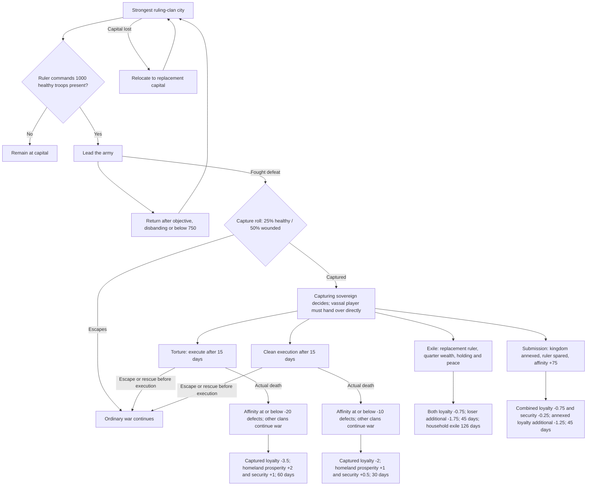

# Ruler capitals and sovereign judgment

## Town-crier news (2026-10-15)

The shared announcement screen also repairs existing ruler-to-ruler diplomacy readability. One spacious, scrolling column contains the headline, complete report, terms and public explanations in separated paragraphs. Body text remains 24 units and left-aligned; long reports never shrink or truncate. Portrait captions hold only short roles. The central divider is removed from the artwork while surrounding Reign framing remains exact; native long-report scrolling and pause/input acceptance are still required.

Use the approved Diplomacy Announcement artwork for a saved queue of reports. Pause campaign time while each report is open; acknowledge before resuming or presenting the next report. Defer opening during loading, saving, battles, conversations, other inquiries and unavailable map UI. Preserve unread reports and acknowledged IDs through native save/load; do not replay past judgments during migration. Long prose scrolls within the existing clean text apertures without altering fixed art.

Eligible categories are ruler/rebellion-leader captures, execution sentences, executions, ruler settlements/releases/rescues, rulings between noble houses, neighboring-realm rulings, major world events, and existing diplomatic decisions. Ordinary captures never create a popup. Report the onset and end of timed kingdom events, including famine, pestilence, crime waves, trade collapse/booms, construction slowdown/golden ages, unrest/unity, harvests, village growth and law/order; also report actual border wars, reconciliation and orderly succession.

Web Options has an Announcements section with a default-on popup master and eight independent types. Changes affect presentation only. Every new report also reaches the normal text window. Disabling a type clears its unread popups, so re-enabling does not replay a backlog. Settings unavailability before first confirmation defers presentation.

Write public news: name the principals and realms, explain what happened, then state the confirmed ruling and consequences. Use authored factual descriptions and resolved decisions; omit trait votes, affinity values, charm rolls, pressure scores and metadata labels. Distinguish a future sentence from an actual execution and from a successfully applied political settlement. Do not invent remorse, motives, casualties, payments or transfers. A golden age accelerates construction; it does not imply a prosperity effect that the event does not grant.

Eight additional native cases, RUL-NEWS-001 through 008, extend the original 65-case certification. See the manifest and [news procedure](testing/FEATURE_HARNESSES.md#town-crier-news-2026-10-15). Original case results remain attributed to their actual artifacts; the new scope remains incomplete until its own evidence is recorded.

## Native options and culture observations (2026-10-14)

Ruler diagnostics publish the nine actual cached preferences, `lifeDeathCycleDisabled`, and fixed read-only campaign-option rows with availability, native value and enum names. A missing native property is unavailable evidence. Holding snapshots include actual settlement, owner-clan and governor cultures, governor identity, the native governor-culture effect, and at most 64 explained loyalty lines of 256 characters each. Use these values for native governor/mortality/difficulty assertions; IDs and fixtures alone cannot prove them.

The `mortality` ruler fixture keeps the existing five-field contract and all exact paused, armed owned Current/recovery gates. Require `heroId=main_hero`, empty `otherHeroId`, an idle safe fortification, and amount `0` or `1`. It attempts the ordinary `CampaignOptions.IsLifeDeathCycleDisabled` setter with the native bypass disabled, recording `lifeDeathBefore`/`lifeDeathAfter`. The production hook decides whether the attempt succeeds. Test both the enabled protection and disabled preference; restore native mortality to enabled and original preferences before advancing or saving. There is no arbitrary option setter or difficulty mutation. A returned fixture receipt is not a behavioral pass.

Approved behavior: 2026-10-11, with controlled fixtures and assertion-driven elapsed time replacing fixed soaks. Implementation/deployment authorized 2026-10-13 while Windows is locked. Native acceptance remains pending; do not advance a campaign or infer release readiness from compilation.

The diagram shows ordinary wars. Civil-war choices are specified separately below; they do not receive these settlement-effect packages. Execution branches forbid ransom during sentencing. All temporary effects fade during their final third.

## Capitals and battle protection

NPC rulers reside at the ruling clan's strongest-garrisoned city by native combat strength, excluding militia and visitors. Keep the selected capital until lost. Replacement order: ruling-clan city, other kingdom city, castle refuge, native fugitive handling. Preserve existing valid player manual designations; initialize other existing saves from current state. A castle refuge is not a full Court capital. Automatic city capitals also enable the existing Court designation state.

Depart only commanding at least 1,000 physically present healthy soldiers, excluding wounded and approaching army parties. Gather at the capital. Relocation and return are exceptions. Return below 750 healthy troops, after the objective finishes, or after disbanding; finish an active battle first. Players retain free travel.

Rulers have one capture decision per fought defeat: 25% healthy, 50% wounded. Cover AI field/siege battles, player victories/defeats and capital residents after siege. Preserve surrender and unrelated arrests. Intercept before capture; never create false prisoner events followed by release. Native troop capture stays unchanged.

Life and death is required while its feature is enabled; combat-death difficulty remains unchanged.

## Judgments

Sovereigns decide regardless of government type. AI realm captures trigger judgment at capture. A player vassal/mercenary keeps ordinary prisoner control until direct handover; dungeon donation alone is insufficient. Player sovereigns can choose and suffer all outcomes.

| Verdict | Permanent resolution |
|---|---|
| Torture and humiliation | Execution after 15 campaign days. Leaders at affinity <= -20 toward the condemned ruler defect with fiefs; >= -19 remain at war. |
| Clean execution | Execution after 15 days. Leaders <= -10 defect with fiefs; >= -9 remain at war. |
| Exile | Immediate peace, one city (castle only if no city), 25% available realm wealth without debt, and a replacement ruler. |
| Submission | Noble clans and fiefs join the victor; former ruler becomes a clan leader and gains exactly +75 personal affinity toward the victor. |

Execution cutoffs use personal directional Reign affinity frozen at sentencing. Political/stat consequences start at actual death. Native heir/election succession and execution honor/relationship costs remain. Native execution relation changes are observed on their effective pairs and retained in authoritative Reign affinity; additional unauthorized-execution reactions remain separate.

Clans must still belong to the defeated kingdom when the execution occurs. A clan that has already joined a third kingdom is unaffected by the split. Defectors retain the fiefs they hold at execution, including later acquisitions; these holdings receive the conquest effect.

Sentenced rulers cannot be ransomed, sold, exchanged or voluntarily released. Reject the entire paid release before payments. Normal escapes, battle rescue and player prison breaks cancel the sentence and pending political consequences. War remains active during sentencing; after cancellation ordinary war rules resume. Recapture requires a new judgment and fresh 15 days. Same-kingdom custody transfers preserve sentencing. Torture is history/flavor without early lethal damage.

Exile: collect one quarter from available treasury and each noble clan leader's gold, proportionally with integer rounding, excluding earmarked wallets. The eligible defeated leader with highest affinity toward the conqueror succeeds. Former ruler, spouse and minor children form a new landless clan at a foreign court; adult heirs retain the original clan/fiefs. Without an adult original-clan heir, redistribute its fiefs within the defeated kingdom. Preserve the controlled player hero and update player-clan ownership. Prevent kingdom joining, mercenary service and kingdom founding for 126 days; afterwards native rules apply. No protected truce. Exile is unavailable without a replacement ruler and a concession holding.

Unauthorized player vassal/mercenary execution before handover uses native execution without the new kingdom split/stat package. Additionally, living adult lords of both kingdoms gain -30 affinity toward the player; their own sovereign gains -60 instead of -30. Snapshot membership before death, preserve native effective-pair behavior, and apply each new reaction once.

## Temporary effects

All modifiers are daily additions without initial shocks, at full strength for two thirds of their duration and linearly fading during the last third.

| Outcome | Loyalty per day | Other daily effects | Duration |
|---|---|---|---|
| Torture | Conquered holdings -3.5 | Homeland +2 prosperity, +1 security | 60 (40 full +20 fade) |
| Clean | Conquered holdings -2 | Homeland +1 prosperity, +0.5 security | 30 (20+10) |
| Exile | Both realms -0.75; defeated additional -1.75 = -2.5 | Concessions/reparations | 45 (30+15) |
| Submission | Combined realm -0.75; annexed additional -1.25 = -2 | Combined realm -0.25 security | 45 (30+15) |

Homeland is ownership when the war began. Migrated wars without complete prior evidence explicitly use feature initialization as their baseline. Conquered holdings include defecting fiefs and later captures from the defeated realm during the active effect; later captures inherit the original expiry/fade. Effects apply only while the relevant realm owns the holding. Cap this system's combined loyalty penalty at -3.5; native modifiers remain outside the cap. Use the strongest prosperity/security bonus and strongest security penalty. Towns and castles receive applicable native stats; only towns use native rebellion mechanics.

Daily ruler modifiers are fixed final changes after other model modifiers, retaining native floors and ceilings. Existing native percentage factors must not amplify these amounts or the -3.5 loyalty cap. Native explanations retain their totals and identify the ruler contribution separately. A 2026-10-14 native comparison found prosperity bonuses of 2.08, 2.16 and 2.24 instead of 2; the final-delta integration corrects that amplification and requires native revalidation.

The agreed culture change removes the foreign-GOVERNOR loyalty penalty only. Keep foreign owner -3, matching governor +1 and policy effects.

Recaptured homeland (confirmed by the user 2026-10-13): a holding owned by the victor at war start retains its homeland classification if lost and regained. It receives execution homeland bonuses without the conquest loyalty penalty. Submission still applies the combined-realm penalty, but not the additional annexation penalty to regained homeland. The user's confirmation matches the implemented war-start ownership rule and its regression coverage.

## Civil wars and fugitives

No new settlement-effect package applies to civil wars. Rebel capture of the old ruler allows recognized independence (release and peace), execution after 15 days (independence and continuing war under the old kingdom's successor), or reunification under the rebel leader (old ruler survives as an ordinary original-clan member). Use an eligible heir for that original clan; without one, the old ruler may remain clan leader. Preserve wartime clan sides; do not apply ordinary-war affinity defections or +75 submission affinity.

Royal victory retains defeated-lord freedom, imprisonment and execution, with execution delayed 15 days. Pending leader sentences prevent premature civil-war resolution. Escape/rescue cancels pending leader resolution. Another condemned leader escaping after completed settlement is exiled alone into a landless clan; original clan/fiefs stay with the successor and war stays resolved. Their ordinary kingdom joining is restricted for 31.5 days, with immediate player recruitment as either vassal clan or individual companion through the existing signed action/consent pipeline and normal eligibility/capacity.

AI choice uses Foundation traits normalized to 0-100 (stored -2..2 values map through the existing Trait100 conversion), with missing traits neutral at 50. Outcome weights are exp((score-highest)/12) over eligible outcomes. Save the draw/result. Ordinary scores: torture .45 vengeance+.35(100-mercy)+.10 aggression+.10 hostility; clean .45(100-mercy)+.25 duty+.20 tradition+.10 hostility; exile .65 mercy+.20 compassion+.15 affinity; submission .40 ambition+.35 pragmatism+.15 power+.10 mercy. Affinity/hostility normalize personal affinity -100..100 to 0..100. Rebel scores: independence .40 mercy+.35 legacy+.25(100-power); execution uses torture; reunification .50 ambition+.35 power+.15 pragmatism. Existing individual defeated-lord mercy policy remains authoritative.

## Options, persistence and testing

Deterministic AI judgment testing (2026-10-15): the bounded `judgment_draw` fixture prepares one valid native draw for an exact free opposing ruler pair under all existing disposable Current/recovery gates. A real capture and production context/eligibility/weight calculation still determine the verdict; no traits, affinity or outcome is overwritten. Changed scope/custody/authority invalidates the control, and existing saved draws remain immutable. Use it to exercise all eligible ordinary/civil branches without waiting for random selection. Fixture receipts and compiled guards are not native outcome acceptance; retain actual consequences, save/reload and cleanup evidence. [Procedure](testing/FEATURE_HARNESSES.md#ruler-prisoner-fixtures-2026-10-14).

Personality resolution (2026-10-15): judgment context first uses the campaign's Foundation traits, including editor corrections. If no Foundation evidence is present, use the campaign-version-appropriate shipped character personality without constructing a profile or calling a provider. Dynamic rulers use the existing deterministic trait model with an identity-checked native traits/skills snapshot. Only genuinely missing evidence is neutral. Existing partial campaign traits remain authoritative and their absent keys remain neutral. New decisions persist `TraitSource` and nullable `VictorAffinity` alongside traits, draw and verdict; older saves retain unknown affinity as null and keep their existing verdict. Native certification must independently reproduce the weighted choice and verify these frozen inputs survive reload.

Court economic-report persistence (2026-10-14): enlarged realm snapshots require bounded save chunks. `_reignCourt_economicReportStateChunks_v2` retains the complete snapshot and shipment receipts; the old raw key is written empty and remains readable for ordinary legacy JSON or a lossless compressed legacy envelope. Invalid restoration fails the load instead of discarding shipment records. Product contracts and archive inspection are separate from native acceptance: load the exact recovered disposable Current with the corrected client, compare its report and ruler clocks, write a drained checkpoint, inspect every archive entry, then reload in a different native instance. Preserve the original outside Game Saves; never repair the protected baseline or another task's save.

Prisoner acceptance setup (2026-10-14): [fixed prisoner fixtures](testing/FEATURE_HARNESSES.md#ruler-prisoner-fixtures-2026-10-14) preserve every existing disposable-save gate and the five exact string fields. `prison_guard` with amount one prepares the actual land-party jailer with native Mounted Patrols/Keen Sight and only their required Riding/Scouting levels; a sentenced prisoner must already be in that party within capacity, and conflicting tier perks refuse. This supports deterministic timer tests without changing escape RNG or suppressing ordinary release/rescue callbacks. The native setup remains confined to the owned save and is discarded by guarded restore.

`ransom_offer`, `barter_release` and `barter_transfer` use 1–4000 existing payer gold and fixed native paid-entry handlers. They require a sentenced NPC in the player party and a free party leader from the defeated realm; no active ransom offer may be overwritten. Barter puts gold first to expose any guard that runs after payment. Native application bypass is off; minimum ransom context fields restore in `finally`. Retain actual gold, roster and sentence assertions separately from the operator fixture receipt. These probes prove neither NPC consent nor the full AI negotiation. Licensed signatures, private fields, constructors and JIT linkage are checked offline; actual native results remain mandatory.

Web Options exposes a master and independent residence, capture, judgment, settlement-effect, civil-war, unauthorized-reaction, governor and mortality switches. All default on. Refresh within five real seconds. Disabling judgments cancels uncommitted sentences; completed death, money, fiefs and clan changes remain. Disabling effects hides their modifiers while their original clocks continue. Disabling mortality enforcement does not itself disable native life/death. Individual preferences persist across master toggles.

Save-backed JSON chunks retain capitals, war footprints, sentencing snapshots, verdicts, deadlines, exile clocks, effect territories, receipts and relationship outbox. Server relation receipts are transactional, generation-bound and included in whole-schema Save Sync. Native death/partial transfers must never be replayed blindly. Uncertain native outcomes block progression until diagnosed/restored on the disposable test run.

Use `reign_get_ruler_test_manifest` and existing guarded `reign_test_structured_actions`. `fixture.ruler_setup` can arrange ruler identity, garrisons, healthy armies, captivity, ownership, loyalty and wounds. It requires an exact armed paused disposable Current and a retained recovery checkpoint; stable operation hashes prevent changed-input/replay mutations. Fixtures only prepare conditions. Production UI/actions and independent native observations prove results. Never synthesize consent, successful execution, a passed case, or a native save/reload receipt.

The manifest owns the native case ledger and assertion-driven schedule. Combine compatible cases, restore conflicting/destructive branches, advance only to the next necessary clock boundary, and stop when assertions pass. Prove full 126-day expiry once while covering compatible shorter clocks. No fixed 180-day soak or five-year simulation is required. Capture statistics are seeded offline; native battle proof establishes wiring separately.

Launch readiness requires all mandatory cases, hardest-difficulty matched control/passive/managed balance trials, fresh-process persistence, installed hashes, healthy drained queues, native/human presentation acceptance, protected-baseline proof and exact run-owned cleanup. Compilation/fixtures alone cannot satisfy readiness. While Windows is locked, only offline/native-assembly binding checks and authorized deployment probes run; retain native cases as pending.

Controlled capture (2026-10-13): `capture_roll` uses one exact-ruler, one-use roll (`amount/4000`; 0 capture, 4000 escape) bound to the armed Current, campaign, timeline and native instance. It is consumed only by production fought-battle/siege capture selection. Intent/consumption is retained in `reign-ruler-fixture-v1`; actual native captivity remains the assertion. The control does not survive reload or apply to surrender/arrest; restore/reprepare with a new operation when needed.

Pending decisions (2026-10-13): Native AI execution must wait for sovereign judgment. Ordinary structured kill requests against a ruler awaiting judgment fail during preflight and cannot schedule a later side effect. Awaiting-handover records are checked after reload and escape; if the player succeeds as sovereign, an existing captive advances to their decision without self-handover. Cover these transitions in RUL-JUDGMENT-002 and RUL-JUDGMENT-003.

Recovery review (2026-10-13): cancelled pending decisions clear obsolete context failures. An interrupted exile or submission remains Applying with its failure and receipts, even after the prisoner has been released; observation cannot silently relabel partially applied politics as an escape. Runtime availability requires successful native hook binding. The provider-free licensed probe verifies availability while hooks are bound and unavailability after unpatching. Native cases remain pending.

Native player execution (2026-10-13): preserve Bannerlord's heir-selection flow. A native execution death mark records acceptance, not death or completed consequences. Save the pending request, keep it pending through death-custody release, and observe the subsequent native death-mark completion without issuing the execution again. Only actual death records the execution receipt and starts the political/stat package; its original day anchors the effect timer. The death-mark completion scope retains native relationship costs and prevents premature civil-war settlement. Rejected native requests remain explicit failures. Verify the real heir choice and subsequent world state in RUL-JUDGMENT-015; offline state contracts alone do not prove that UI.

Native arrival regression (2026-10-13): RUL-CAP-007/008 must include a pending return marker after the ruler has reached the capital. Reaching that destination ends the relocation exception immediately, before the next hourly tick, so 999 healthy troops still cannot depart and 1,000 can. Keep exact troop boundaries paused between setup and the native departure action: ordinary hourly attrition changed a single-party 999 fixture to 810 during the first live pass. The original failure and the corrected native retest must both remain in the evidence ledger; a fixture or offline policy pass alone does not close these cases.

Native roster and observation fixtures (2026-10-13): `fixture.ruler_setup` additionally accepts `party` and `snapshot`, with the same five exact string fields, verification control, paused armed run-owned Current, campaign/timeline/native instance, protected baseline and retained recovery checkpoint. `party` requires a free existing party leader and sets 0–4000 healthy troops while preserving all heroes, location, army and orders; requests below the healthy hero count fail. It does not make a ruler leave or fabricate combat. `snapshot` requires amount zero and observes existing state without changing gameplay; retaining its operation receipt is not a semantic pass. Observations include party healthy/total, army leader, wound/fugitive/HP state and native loyalty/security/prosperity changes. A partyless ruler has zero army strength. Native movement or judgment remains the acceptance action. Reobserve CurrentSettlement immediately before any explicit LeaveSettlement call: an NPC may depart between paused command frames. Restore the retained checkpoint after uncertain setup, without saving the failed branch.
